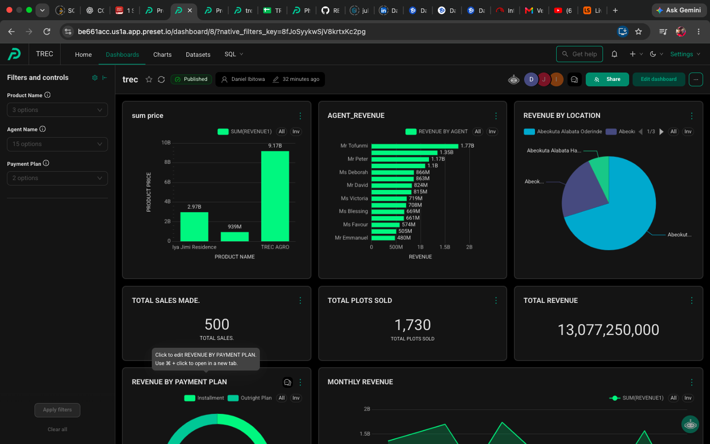

# REAL_ESTATE_ANALYSIS.
Real estate sales analysis using Excel and Apache Superset to explore revenue performance, property sales, agent performance, and payment trends. 

## Dashboard Preview

### Main Dashboard

### Additional Dashboard View

# Real Estate Sales Analysis

## 1. Project Overview

This project focuses on analysing real estate sales data to understand sales performance, revenue generation, property demand, and the performance of sales agents.

The analysis was carried out using Excel for data preparation and Apache Superset for data visualisation and dashboard development.

The dataset contains 500 simulated real estate transactions covering different properties, locations, payment plans, and sales agents.

## 2. Project Objectives

The major objectives of this project are to:

- Analyse the revenue generated from different real estate products.
- Identify properties contributing the most to total revenue.
- Evaluate the performance of individual sales agents.
- Examine sales distribution across different locations.
- Compare outright and installment payment plans.
- Monitor monthly revenue trends.
- Identify patterns that can support better sales and business decisions.

## 3. Dataset Description

The dataset contains 500 simulated transaction records with the following columns:

| Column | Description |
|---|---|
| Product_Name | Name of the property or real estate product |
| Quantity | Property size or lease duration |
| Price | Unit price of the property |
| Plots | Number of plots sold |
| Revenue | Total transaction value |
| Date | Transaction date |
| Agent_Name | Name of the sales agent |
| Payment_Plan | Payment arrangement |
| Location | Property location |

**Dataset Note:** The dataset was synthetically generated for learning and portfolio development. It does not represent actual company transactions or verified market sales.

## 4. Tools Used

- **Google sheet:** Data preparation and organisation.
- **Apache Superset (Preset):** Data visualisation and dashboard development.
- **GitHub:** Project documentation and version control.

## 5. Key Performance Indicators (KPIs)

The dashboard tracks the following performance indicators:

- Total Revenue
- Total Plots Sold
- Total Sales Transactions
- Average Sales Value

## 6. Dashboard Visualisations

The dashboard contains the following visualisations:

- Revenue by Product
- Revenue by Sales Agent
- Revenue by Location
- Revenue by Payment Plan
- Monthly Revenue Trend
- Sales and Revenue Breakdown by Property

### Dashboard Preview

## 7. Dashboard Interactivity

Global filters were incorporated to allow users to explore the dashboard dynamically.

The available filters include:

- Product Name
- Agent Name
- Payment Plan

These filters allow users to examine sales performance across different business categories.

## 8. Project Learning Outcomes

Through this project, I gained practical experience in:

- Preparing and organising structured sales data.
- Working with business performance indicators.
- Building interactive dashboards.
- Selecting appropriate visualisations for business questions.
- Using filters to improve dashboard interactivity.
- Documenting and presenting analytical projects using GitHub.

## 9. Conclusion

This project demonstrates how data analysis and visualisation can transform structured sales records into meaningful business insights.

The dashboard provides a way to examine revenue performance, compare products, evaluate agent contributions, and monitor sales trends over time.

---

**Project Status:** Completed

**Author:** Ibitowa Daniel Ayomikun
